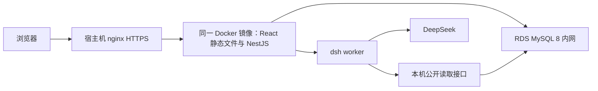

# 当前部署架构

## 2026-10-19 史料库与站内反馈上线

[正式史料库](https://histree.wiki/library) 已开放。应用提交 `9041ea2113bff8d1e42ef457547da29e9eb46840` 经[生产流水线](https://github.com/greed-216/histree/actions/runs/39219728536)发布，ECS release 指针、实际镜像和健康均已核实；保留上一版本用于应用回滚。

MySQL 新增独立阅读库、原文快照和私有反馈表，导入 26 部书、376,987 个阅读段落、2,267 份既有引用原文及 2,190 个同底本段落映射。未改旧人物、事件、关系、出处或录入账本。无法唯一核对的旧出处继续使用片段阅读。

原生 MySQL 全量哈希读回、相同版本重跑、实际应用服务的搜索/定位和事务回滚反馈探针均通过；云端构建、lint、回归、独立 MySQL/PostgreSQL 兼容检查与镜像校验通过。正式域名匿名接口、深链接、原文字节哈希、私有反馈读取拒绝和无效反馈拒绝通过；浏览器确认书目、搜索、连续翻卷、旧引用跳转及高亮，反馈邮箱选填。验收没有发送邮件、调用付费模型或留下测试反馈。

生产入口为 `https://histree.wiki/`，北京 ECS；原 IP 入口 `https://123.56.189.146/` 保留。容器 `histree-api` 仅暴露宿主机 `127.0.0.1:3000`，前端根路径与 `/api/v1` 同源。技术栈为 Node.js 24、NestJS/TypeScript、React/Vite，不含 Go 服务。

生产数据库是 RDS MySQL 8，ECS 使用 `rm-2zeiv0233csd46w9v.mysql.rds.aliyuncs.com` 内网地址、`histree` 数据库，连接凭据仅在 `/opt/histree/runtime.env`。公开读取由 MySQL 数据层显式检查 published 状态及关系端点；网页登录与管理写入已移除，资料发布改用独立工具。

`apps/api/Dockerfile` 构建两个应用，通过 pnpm deploy 仅保留 API 生产依赖，以非 root 用户运行。镜像带 Git 提交标签和 revision 元数据。不要从旧本地检出覆盖当前主线的前端。

## 开发与发布流程

1. PR 调用 `application-checks.yml`，使用 Node 24、冻结锁文件和临时 MySQL 8 服务；不需要生产凭据。
2. 同一个工作流编译两个应用，运行测试，构建并验收实际 linux/amd64 镜像；验收包含 MySQL 就绪、深链接、精确长卷哈希、公开读接口和停用接口。
3. `deploy-api.yml` 仅在 main 且 `ECS_DEPLOY_ENABLED=true` 时部署，使用 `ecs-production` 环境。凭据由该环境提供。
4. ECS 下载已验收 artifact，验证 SHA-256 和精确文件清单，运行 `release.sh`。GitHub token 留在 runner；宿主机只接收短期签名地址。
5. 发布脚本独占发布锁，保留 runtime.env 和 nginx/TLS。启动或后续验收失败都恢复前一个 release；仅验收成功后更新 current-release 指针。

普通应用部署不应用数据库 DDL、不发布史料、不启动付费模型验证。健康检查与 AI 启用开关独立。模型功能关闭时页面与数据库仍可正常通过就绪检查。

当前域名证书及备案模式由宿主机单独管理；域名是否开放须看实际 vhost，不能仅凭 DNS 或应用健康推定。证书安装与续期见 [ECS 操作](../deploy/ecs/README.md)。

## 2026-10-19 正式域名开放

用户确认备案通过，网站备案号为 **京ICP备2026006671号-2**。公共页脚展示完整备案号并链接 `https://beian.miit.gov.cn/`。页脚提交 `e21112e7b3965edaac79aeda601a4b5035d80b04` 经 [生产发布流程](https://github.com/greed-216/histree/actions/runs/39192522027) 验证并部署，ECS 实际镜像和 release 指针均已核实。

域名 vhost 已由 `pending` 切换为 `serve`，复用原阿里云证书；HTTP 308 跳转至同域 HTTPS。原配置保存在 `/opt/histree/nginx-backups/domain-before-icp-20261019.conf`，IP 网关与运行环境保留。此操作没有配置证书自动续期。

公网严格 TLS 验证、SPA 深链接、静态资产与长卷哈希、已发布数据读取、匿名会话签发、外域拒绝共 72 项检查通过；桌面及 390/320px 页脚验证通过，手机浏览器已加载真实数据且未报告页面或网络错误。AI 状态可用；本次未发起付费模型调用。

2026-10-10 切换前完整记录及回退证据见 [MySQL 迁移档案](MYSQL_MIGRATION.md)。旧 PostgreSQL SQL 保存在 `database/legacy-postgres`，不能作为当前部署步骤。旧 Pages、Render 与 Edge 工作流不再使用。
